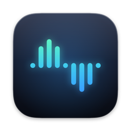
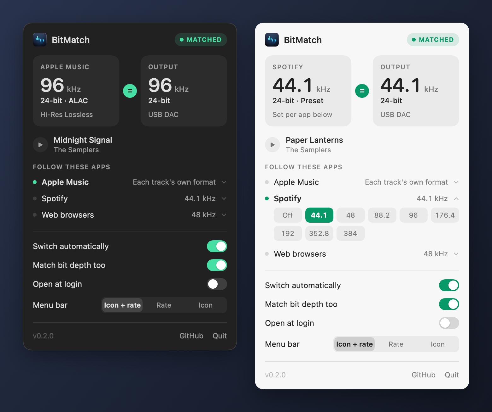

<p align="center">
  
</p>

<h1 align="center">BitMatch</h1>

<p align="center">
  지금 재생 중인 소리의 샘플레이트에 DAC를 자동으로 맞춰 줍니다.<br>
  Apple Music, Spotify, 그리고 Mac의 다른 앱들을 위한 작은 메뉴 막대 앱.
</p>

<p align="center">
  <a href="https://github.com/qkdeoddl12/BitMatch/releases/latest"><b>다운로드</b></a>
  ·
  <a href="README.md">English</a>
</p>

<p align="center">
  <a href="https://github.com/qkdeoddl12/BitMatch/releases/latest"></a>
  <a href="https://github.com/qkdeoddl12/BitMatch/releases"></a>
  
  
  <a href="LICENSE"></a>
</p>

<p align="center">
  
</p>

## 왜 필요한가요

Apple Music은 44.1 kHz부터 192 kHz까지 다양한 무손실 음원을 제공합니다. Spotify는 44.1 kHz이고,
YouTube는 대부분 48 kHz입니다. 그런데 macOS는 출력 장치의 샘플레이트를 재생 중인 소리에 맞춰
바꿔 주지 않습니다. 오디오 MIDI 설정에 지정된 값으로 전부 변환됩니다. DAC가 192 kHz로 고정돼
있으면 44.1 kHz 앨범은 리샘플링되고, 44.1 kHz로 고정돼 있으면 96 kHz 고해상도 음원의 정보가
잘려 나갑니다.

BitMatch는 Mac용 자동 샘플레이트 전환 앱입니다. 어떤 앱이 재생 중인지 알아내서 출력 장치를
그 앱에 맞는 포맷으로 바꿉니다. 오디오 MIDI 설정을 다시 열 필요가 없습니다.

도움이 됐다면 스타를 눌러 주세요. 다른 사람들이 찾는 데 도움이 됩니다.

## 무엇을 맞추나요

| 앱 | 출력 장치 설정 | 알아내는 방법 |
| --- | --- | --- |
| **Apple Music** | 곡마다 정확한 샘플레이트와 비트뎁스 | Music이 곡의 포맷을 기록함 |
| **Spotify** | 44.1 kHz / 24-bit | Spotify 음원은 무손실 포함 전부 44.1 kHz |
| **웹 브라우저** (YouTube 등) | 48 kHz / 24-bit | 웹 영상의 오디오는 대부분 48 kHz |
| **그 밖의 앱** | 직접 고르기 전까지는 건드리지 않음 | 사용자가 선택 |

지정 값은 팝오버에서 앱별로 바꿀 수 있습니다. 곡의 포맷을 알려 주는 앱은 Apple Music뿐이라,
곡 단위로 맞출 수 있는 것도 Apple Music뿐입니다. 나머지 앱은 앱마다 하나의 값을 씁니다.

## 기능

- **재생 중인 앱을 따라갑니다.** Spotify를 틀면 DAC가 44.1 kHz로, Apple Music에서 고해상도
  앨범으로 돌아가면 96 kHz로 바뀝니다.
- **샘플레이트와 비트뎁스 모두.** 둘 다 설정하며, 곡보다 낮은 비트뎁스는 절대 고르지 않습니다.
- **한눈에 보이는 상태.** 소스와 출력 포맷을 나란히 보여 주고, 일치/불일치를 배지로 표시하며,
  문제가 있으면 이유를 설명합니다.
- **장치 지원 범위 인식.** 지정 값은 DAC가 지원하는 샘플레이트만 보여 줍니다. 곡의 샘플레이트를
  지원하지 않으면 가장 가까운 정수배를 고르고 알려 줍니다.
- **음악이 우선.** 음악 앱이 브라우저 탭보다 우선하고 짧은 소리는 무시합니다. 뒤에서 영상이
  자동 재생돼도 듣고 있는 앨범에서 DAC를 빼앗지 않습니다.
- **스스로 복구.** 출력 장치를 바꿔도 따라가고, 잠자기에서 깨어나도 복구되며, 로그 리더가
  멈추면 알아서 다시 시작합니다.
- **방해하지 않는 UI.** 메뉴 막대에 아이콘, 현재 샘플레이트, 또는 둘 다 표시합니다. Dock 아이콘도,
  창도, 계정도, 네트워크 접속도 없습니다.
- **네이티브.** SwiftUI와 Core Audio로 만들었고 2 MB 미만입니다. 라이트/다크 모드, 한국어/영어 지원.

## 설치

1. [최신 릴리스](https://github.com/qkdeoddl12/BitMatch/releases/latest)에서 `BitMatch.zip`을 받습니다.
2. 압축을 풀고 **BitMatch**를 응용 프로그램 폴더로 옮깁니다.
3. 실행합니다. Apple 공증을 받지 않은 앱이라 처음 실행은 차단됩니다.
   **시스템 설정 › 개인정보 보호 및 보안**에서 아래로 내려 **그래도 열기**를 누르세요.
   또는 터미널에서 격리 속성을 직접 지울 수 있습니다.

   ```bash
   xattr -dr com.apple.quarantine /Applications/BitMatch.app
   ```

릴리스 빌드는 Apple silicon Mac용입니다.

### 소스에서 빌드

Xcode Command Line Tools만 있으면 됩니다(`xcode-select --install`). Xcode 전체는 필요 없습니다.

```bash
git clone https://github.com/qkdeoddl12/BitMatch.git
cd BitMatch
./build.sh
open BitMatch.app
```

어떤 앱을 따라갈지 정하는 로직은 오디오 장치를 건드리지 않고 점검할 수 있습니다.

```bash
.build/release/BitMatch --selftest
```

## 요구 사항

- macOS 14.2 이상. **macOS 27.2**에서 개발하고 테스트했습니다. [제한 사항](#제한-사항)을 참고하세요.
- 관리자 계정. macOS는 관리자에게만 시스템 로그 읽기를 허용하는데, BitMatch는 여기서
  Apple Music 곡의 포맷을 알아냅니다.
- Apple Music은 **Music › 설정 › 오디오 품질**에서 무손실 오디오를 켜 두어야 합니다.

## 동작 원리

두 가지를 알아내야 합니다. 누가 재생 중인지, 그리고 어떤 포맷인지.

**누가 재생 중인지.** Core Audio는 출력 스트림을 열어 둔 프로세스 목록을 관리합니다. BitMatch는
이 목록을 2초마다 확인합니다. Apple Music과 Spotify는 재생/일시정지를 직접 알려 주기 때문에
즉시 반영됩니다.

**어떤 포맷인지.** Apple은 재생 중인 곡의 포맷을 알려 주는 API를 제공하지 않습니다. 대신 Music 앱은
곡이 시작될 때마다 시스템 로그에 포맷이 담긴 줄을 남깁니다.

```
[Rendition Lossless] [SampleRate 96000] [BitDepth 24]
```

BitMatch는 로그에서 이 줄만 지켜봅니다. 다른 앱은 이런 정보를 내놓지 않아서 지정 값을 씁니다.

어느 쪽이든 그다음에는 Core Audio에 기본 출력 장치를 해당 물리 포맷으로 바꾸도록 요청합니다.
어떤 데이터도 Mac 밖으로 나가지 않고, 오디오 신호 자체는 건드리지 않습니다.

## 진짜 비트퍼펙트 재생을 위해

포맷을 맞추는 것은 필요조건일 뿐입니다. Apple Music에서는 아래도 확인하세요.

- **Music › 설정 › 재생:** 음량 자동 조절, 사운드 향상, 크로스페이드 끄기.
- **Music › 윈도우 › 이퀄라이저:** 끄기.
- **음량:** Music의 음량 슬라이더는 100%. 음량은 DAC나 앰프에서 조절하세요.

## 자주 묻는 질문

**BitMatch가 소리를 바꾸나요?**
오디오 신호는 전혀 건드리지 않습니다. 출력 장치의 포맷만 바꿔서 macOS가 변환할 일이 없게
만듭니다. 앱이 내보낸 소리가 그대로 나갑니다.

**어딘가로 데이터를 보내나요?**
아니요. 앱에 네트워크 코드가 없고, 분석 도구도 계정도 없습니다. 소스는 전부 여기 있습니다.

**열 때 macOS가 왜 경고하나요?**
공증에 필요한 Apple 개발자 계정이 유료인데, 이건 무료 프로젝트입니다. 받은 파일을 믿기
어렵다면 소스에서 직접 빌드하세요. 명령 한 줄이면 됩니다.

**특별한 권한이 필요한가요?**
화면 기록, 손쉬운 사용, 마이크 권한은 필요 없습니다. 관리자 계정만 있으면 됩니다. macOS가
시스템 로그를 읽는 데 관리자 계정을 요구하기 때문입니다.

**전환될 때 소리가 끊기나요?**
포맷이 실제로 바뀔 때만, DAC가 다시 동기화되는 아주 짧은 무음이 있습니다. 같은 포맷의 곡이
이어지면 끊김 없이 재생됩니다.

**디스플레이가 있는 외장 DAC를 씁니다. 표시도 따라 바뀌나요?**
네. BitMatch는 장치의 물리 포맷을 바꾸고, DAC는 그 값을 표시합니다.

## 제한 사항

- 곡 단위로 맞추는 것은 Apple Music뿐입니다. 나머지는 앱별 지정 값이고, 브라우저는 장치 설정과
  상관없이 내부에서 한 번 리샘플링합니다. 이런 앱에서 샘플레이트를 맞추는 것은 변환이 한 번 더
  일어나는 것을 막아 줄 뿐, 비트퍼펙트가 되는 것은 아닙니다.
- 스트리밍으로 재생하는 Apple Music 곡으로 검증했습니다. 다운로드한 곡이나 보관함의 로컬 파일은
  테스트하지 못했고, 감지되지 않을 수 있습니다.
- 장치의 샘플레이트가 바뀔 때 소리가 아주 잠깐 끊깁니다. 하드웨어가 다시 동기화되는 과정이며,
  포맷이 실제로 바뀔 때만 생깁니다.
- Tidal, Qobuz, Roon, Audirvana는 DAC를 독점해서 직접 전환할 수 있습니다. 이런 앱은 "전환 안 함"으로
  두세요. BitMatch가 모르는 앱은 기본값이 "전환 안 함"입니다.
- Apple Music 감지는 문서화되지 않은 로그 줄을 읽는 방식이라 macOS 업데이트로 형식이 바뀔 수 있고,
  이전 macOS 버전에서는 문구가 다를 수 있습니다. Apple Music이 재생 중인데 "재생 대기 중"으로
  표시되면 macOS 버전과 함께 [이슈를 남겨 주세요](https://github.com/qkdeoddl12/BitMatch/issues).
- 블루투스와 AirPlay 출력은 샘플레이트가 고정이라 전환할 것이 없습니다.

## 크레딧

시스템 로그에서 포맷을 읽는 방식을 처음 선보인 [LosslessSwitcher](https://github.com/vincentneo/LosslessSwitcher)에서
영감을 받았습니다. BitMatch는 처음부터 새로 작성한 독립 구현입니다.

BitMatch는 Apple, Spotify, Google과 관련이 없습니다. Apple Music, Spotify, YouTube는 각 소유자의 상표입니다.

## 라이선스

[MIT](LICENSE)
