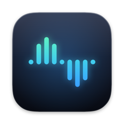
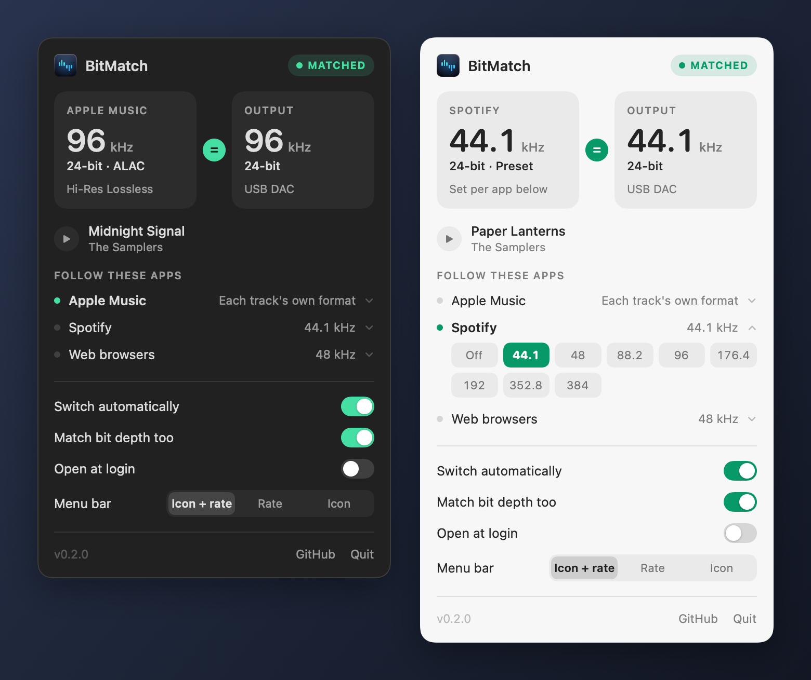

<p align="center">
  
</p>

<h1 align="center">BitMatch</h1>

<p align="center">
  Your DAC, always at the sample rate of whatever is playing.<br>
  A tiny menu bar app for Apple Music, Spotify, and the rest of your Mac.
</p>

<p align="center">
  <a href="https://github.com/qkdeoddl12/BitMatch/releases/latest"><b>Download</b></a>
  ·
  <a href="README.ko.md">한국어</a>
</p>

<p align="center">
  <a href="https://github.com/qkdeoddl12/BitMatch/releases/latest"></a>
  <a href="https://github.com/qkdeoddl12/BitMatch/releases"></a>
  
  
  <a href="LICENSE"></a>
</p>

<p align="center">
  
</p>

## Why

Apple Music streams lossless audio at anything from 44.1 kHz to 192 kHz. Spotify is 44.1 kHz.
YouTube is mostly 48 kHz. macOS never changes your output device to match any of them: whatever
rate the device happens to be set to in Audio MIDI Setup is what everything gets converted to.
A 44.1 kHz album through a DAC sitting at 192 kHz is being resampled, and a 96 kHz Hi-Res track
at 44.1 kHz is losing what you're paying for.

BitMatch is an automatic sample rate switcher for the Mac. It works out which app is playing and
puts the output device in the right format for it. You never open Audio MIDI Setup again.

If it saves you the trip, a star helps other people find it.

## What gets matched

| App | Output device is set to | How BitMatch knows |
| --- | --- | --- |
| **Apple Music** | The exact sample rate and bit depth of each track | Music reports every track's format |
| **Spotify** | 44.1 kHz / 24-bit | Spotify's music catalogue is 44.1 kHz, lossless tier included |
| **Web browsers** (YouTube and so on) | 48 kHz / 24-bit | Most web video carries 48 kHz audio |
| **Any other app** | Left alone, until you pick a rate for it | You choose |

Every preset is yours to change, per app, from the popover. Only Apple Music exposes a per-track
format, so it is the only source BitMatch can match track by track; the others get one rate each.

## Features

- **Follows the app that's playing.** Start Spotify and the DAC goes to 44.1 kHz. Go back to
  a Hi-Res album in Apple Music and it goes to 96 kHz.
- **Sample rate and bit depth.** Both are set, and BitMatch never picks a bit depth lower than the track's.
- **Honest status.** Source and output formats sit side by side, with a clear Matched or Mismatch badge
  and a plain explanation when something is off.
- **Knows your device.** Presets only offer rates your DAC supports. If a track's rate isn't
  supported, BitMatch picks the nearest clean multiple and tells you.
- **Music beats noise.** A music player outranks a browser tab, and short blips are ignored, so a
  video autoplaying in the background doesn't pull the DAC away from your album.
- **Looks after itself.** It follows you when you change output device, recovers after sleep,
  and restarts its own log reader if it stops.
- **Stays out of the way.** Lives in the menu bar as an icon, the current rate, or both. No Dock
  icon, no windows, no account, no network access.
- **Native.** SwiftUI and Core Audio, under 2 MB, light and dark mode, English and Korean.

## Install

1. Download `BitMatch.zip` from the [latest release](https://github.com/qkdeoddl12/BitMatch/releases/latest).
2. Unzip it and move **BitMatch** to your Applications folder.
3. Open it. BitMatch isn't notarized by Apple, so the first launch is blocked. Go to
   **System Settings › Privacy & Security**, scroll down, and click **Open Anyway**.
   Or clear the quarantine flag yourself:

   ```bash
   xattr -dr com.apple.quarantine /Applications/BitMatch.app
   ```

The release build is for Apple silicon Macs.

### Build from source

You need the Xcode Command Line Tools (`xcode-select --install`). Full Xcode is not required.

```bash
git clone https://github.com/qkdeoddl12/BitMatch.git
cd BitMatch
./build.sh
open BitMatch.app
```

To check the logic that decides which app to follow, without touching any audio device:

```bash
.build/release/BitMatch --selftest
```

## Requirements

- macOS 14.2 or later. Developed and tested on **macOS 27.2**; see [Limitations](#limitations).
- An administrator account. macOS only lets admins read the system log, which is where BitMatch
  learns the format of Apple Music tracks.
- For Apple Music, Lossless turned on in **Music › Settings › Audio Quality**.

## How it works

Two questions have to be answered: who is playing, and in what format.

**Who is playing.** Core Audio keeps a list of the processes that have an open output stream.
BitMatch checks it every two seconds. Apple Music and Spotify also broadcast play and pause
themselves, so those are picked up immediately.

**In what format.** Apple gives apps no API for the format of the current track, but each time a
track starts the Music app writes a line to the system log that includes it:

```
[Rendition Lossless] [SampleRate 96000] [BitDepth 24]
```

BitMatch follows the log for exactly that line. Other apps publish nothing comparable, which is
why they use a preset instead.

Either way, BitMatch then asks Core Audio to put the default output device into the matching
physical format. Nothing leaves your Mac, and BitMatch never touches the audio itself.

## For true bit-perfect playback

Matching the format is necessary but not sufficient. In Apple Music, also check:

- **Music › Settings › Playback:** Sound Check, Sound Enhancer, and Crossfade off.
- **Music › Window › Equalizer:** off.
- **Volume:** Music's volume slider at 100%. Set the level on your DAC or amp.

## FAQ

**Does BitMatch change how my music sounds?**
It never touches the audio. It only changes the format of the output device, so that macOS has
nothing to convert. What you hear is what the app sent.

**Does it send anything anywhere?**
No. There is no networking code in the app, no analytics, and no account. The source is all here.

**Why does macOS warn me when I open it?**
Apple charges for the developer account that notarization needs, and this is a free project.
If you'd rather not trust a download, build it from source: it takes one command.

**Does it need special permissions?**
No screen recording, no accessibility, no microphone. It needs an administrator account, because
macOS requires one to read the system log.

**Will I hear it switch?**
Only when the format actually changes, as a brief silence while the DAC re-locks. Two tracks in
the same format play straight through.

**I use an external DAC with its own display. Will the display follow?**
Yes. BitMatch sets the device's physical format, which is what the DAC reports.

## Limitations

- Only Apple Music is matched track by track. Everything else is a per-app preset, and a browser
  resamples internally whatever the device is set to. For those, the right rate avoids a second
  conversion; it does not make playback bit-perfect.
- Verified with streamed Apple Music tracks. Downloaded tracks and local files in your library
  haven't been tested and may not be detected.
- There's a short dropout when the device changes rate. That's the hardware re-locking, and it
  only happens when the format actually changes.
- Tidal, Qobuz, Roon and Audirvana can take exclusive control of a DAC and switch it themselves.
  Leave them on "Don't switch", which is the default for any app BitMatch doesn't know.
- Apple Music detection reads an undocumented log line. A future macOS update could change it, and
  earlier macOS versions may word it differently. If BitMatch shows "Waiting for playback" while
  Apple Music is playing, please [open an issue](https://github.com/qkdeoddl12/BitMatch/issues)
  with your macOS version.
- Bluetooth and AirPlay outputs run at a fixed rate, so there is nothing to switch.

## Credits

Inspired by [LosslessSwitcher](https://github.com/vincentneo/LosslessSwitcher), which pioneered
reading the format from the system log. BitMatch is an independent implementation, written from scratch.

BitMatch is not affiliated with Apple, Spotify, or Google. Apple Music, Spotify, and YouTube are
trademarks of their respective owners.

## License

[MIT](LICENSE)
